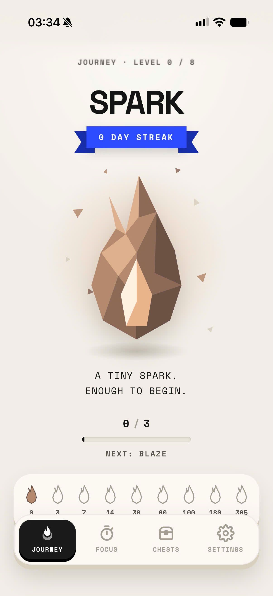
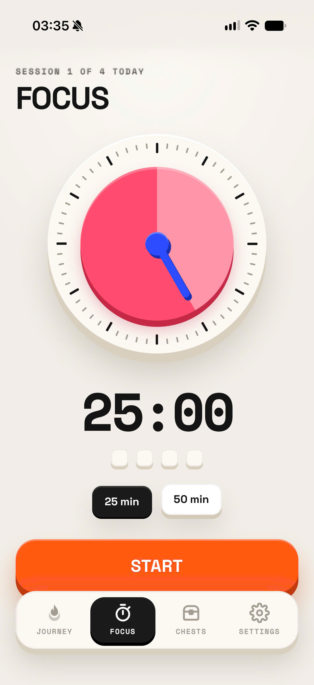
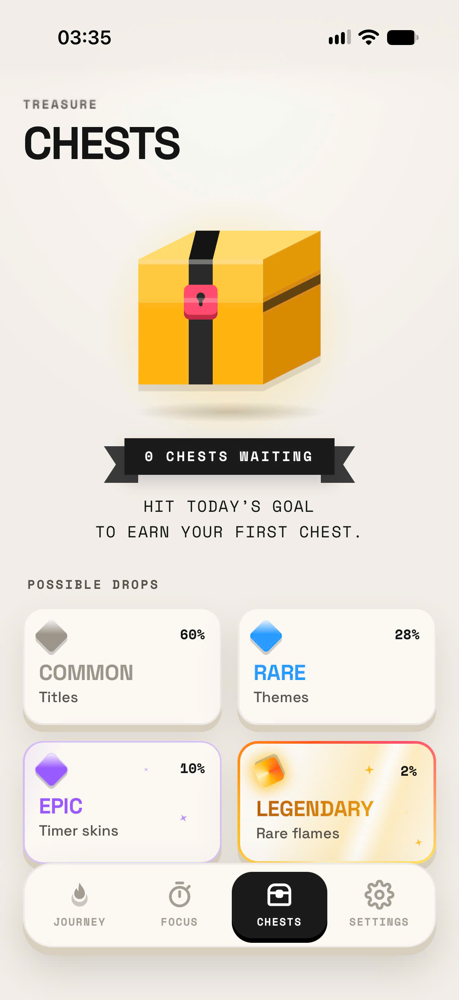
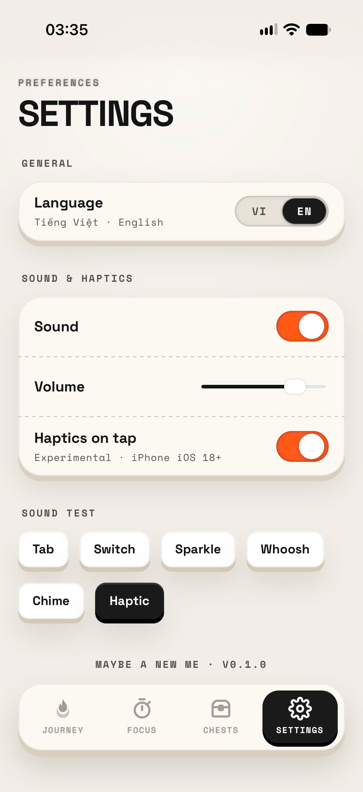

<div align="center">

# 🔥 Maybe A New Me

**A playful, tactile habit & focus app — strict Pomodoro, a low-poly flame that grows with your streak, and gacha chests full of unlockables.**

[](https://github.com/ntkn-gulu/maybe-a-new-me/actions/workflows/deploy.yml)


[**Open the app →**](https://ntkn-gulu.github.io/maybe-a-new-me/)

<br>

&nbsp;
&nbsp;
&nbsp;


</div>

---

## Why

Late-night motivation fades by morning. Habits stick when the daily loop itself feels good.
Maybe A New Me turns studying into a small game: every honest focus session keeps your flame alive, every kept day earns a chest, and every chest might hold something rare.

It is built as a **Progressive Web App**, so it runs on an iPhone home screen and on a PC from one codebase — no App Store, no Mac, no cost.

## Features

### Available now
- 🎛️ **Tactile design system** — extruded 3D buttons that sink and spring back, switches, ribbons, a floating dock tab bar, all on a warm-paper theme.
- 🔊 **Synthesized sound** — every click, tick, whoosh, sparkle and chime is generated live with the Web Audio API (no audio files), set up to keep playing with the iPhone silent switch on.
- 📳 **Experimental iOS haptics** — light taps on iOS 18+ Safari without a native app.
- 🔥 **Journey screen** — a faceted low-poly flame that assembles itself, words of support typed out like a typewriter, progress to the next tier, and a strip to preview all 9 tiers.
- ⏱️ **Focus dial** — a kitchen-timer style dial for 25 / 50 minute sessions, with a springy needle and ratchet clicks.
- 🎁 **Chest preview** — a 2.5D chest and rarity cards; Epic shimmers, Legendary has a spinning gold border, glow and sparkles.
- 🌐 **Vietnamese / English** — switch languages in Settings; every string exists in both.
- 📲 **Installable & offline** — add to the iPhone home screen; fonts and assets are cached for offline use.

### On the way (V1)
- Strict, cheat-resistant Pomodoro timer
- Daily goals, sport days and streak freezes
- Real chests with gacha drops, pity and a collection
- Lofi music and ambient sounds
- Onboarding and JSON backup

See the [Roadmap](#roadmap) for the full plan.

## How it works

### The flame journey
Your streak grows a flame through nine tiers. Locked tiers can be previewed in full color — something to look forward to.

| Tier | Days | Tiếng Việt | English |
|:---:|:---:|---|---|
| 0 | 0 | Tinh Hỏa | Spark |
| 1 | 3 | Xích Hỏa | Blaze |
| 2 | 7 | Kim Hỏa | Gold Flame |
| 3 | 14 | Lam Hỏa | Blue Flame |
| 4 | 30 | Tử Hỏa | Violet Flame |
| 5 | 60 | Huyễn Hỏa | Neon Flame |
| 6 | 100 | Bạch Hỏa | White Flame |
| 7 | 180 | Thất Sắc Hỏa | Prism Flame |
| 8 | 365 | Thiên Hà Hỏa | Galaxy Flame |

### Strict mode *(planned)*
A session only counts if you actually stayed with it:

- **Fixed lengths** — 25 or 50 minutes, nothing shorter.
- **Leaving the app** — up to 1 minute at a time (to answer an important message) and at most 3 minutes per 25-minute session. Beyond that, the session breaks.
- **"Still there?" checks** — at a random moment the app rings a chime that grows louder; miss it for 90 seconds and the session breaks.
- **"What did you do?"** — a one-line note is required to finish a session.
- **Clock tampering** — sessions recorded with a clock that moved backwards are rejected.
- **Daily goal changes apply tomorrow**, so the goal can't be lowered just to save today.
- **Sport days** — on chosen weekdays, a workout check-in plus one session keeps the flame.
- **Streak freezes** — earned every 7 days; you can hold 2, rising to 5 as your streak grows.

### Chests *(planned)*
| Rarity | Daily chest rate | Examples |
|---|:---:|---|
| Common | 60% | Titles |
| Rare | 28% | Themes |
| Epic | 10% | Timer skins |
| Legendary | 2% | Rare flame colors |

- **Pity:** an Epic is guaranteed within 10 chests; Legendary odds rise after 35 chests and it is guaranteed by 50.
- **Duplicates** turn into shards, which can be exchanged for any item you don't own yet.

## Tech stack

| Area | Choice |
|---|---|
| Framework | [React 18](https://react.dev) + [Vite](https://vite.dev) |
| Language | TypeScript (strict) |
| Animation | [Motion](https://motion.dev) (spring physics) |
| State | [Zustand](https://zustand.docs.pmnd.rs) with `persist` (localStorage) |
| Styling | CSS Modules + CSS custom properties |
| Fonts | [Space Grotesk](https://fonts.google.com/specimen/Space+Grotesk) & [Space Mono](https://fonts.google.com/specimen/Space+Mono) via Fontsource, bundled for offline use |
| Sound | Web Audio API synthesis |
| PWA | [vite-plugin-pwa](https://vite-pwa-org.netlify.app) (Workbox) |
| Tests | [Vitest](https://vitest.dev) |
| Lint | ESLint + typescript-eslint + @stylistic |
| Hosting | GitHub Pages via GitHub Actions |

No router, no UI kit, no backend — the app runs entirely on the device.

## Getting started

**Requirements:** [Node.js](https://nodejs.org) 22 or newer.

```bash
git clone https://github.com/ntkn-gulu/maybe-a-new-me.git
cd maybe-a-new-me
npm install
npm run dev
```

Then open <http://localhost:5173>.

| Script | What it does |
|---|---|
| `npm run dev` | Start the dev server with hot reload |
| `npm run build` | Type-check and build the production app into `dist/` |
| `npm run preview` | Serve the production build locally |
| `npm test` | Run the unit tests |
| `npm run lint` | Lint the whole project |

## Running on an iPhone

**Quick preview on the same Wi-Fi**

```bash
npm run dev -- --host
```

Open the printed `Network` address (e.g. `http://192.168.x.x:5173`) in Safari on the phone. On Windows, allow Node.js through the firewall for private networks if asked.
This is for previewing only — offline mode and installing need HTTPS.

**Install as an app**

1. Open <https://ntkn-gulu.github.io/maybe-a-new-me/> in **Safari**.
2. Tap **Share → Add to Home Screen**.
3. Launch it from the home screen icon. Tap once to enable sound.

## Project structure

```
src/
├─ core/        Pure TypeScript game rules — no React, no browser APIs (portable to React Native)
├─ i18n/        Vietnamese + English strings and the useT() hook
├─ stores/      Zustand stores (persisted settings)
├─ features/    One folder per screen: streak (journey), focus, rewards, settings
├─ ui/          Design system: tactile button, switches, ribbon, typewriter text, tab bar
├─ sound/       Web Audio synthesizer and the iOS haptic helper
└─ styles/      Design tokens and global styles
tests/          Vitest unit tests
public/icons/   App icons (SVG + PNG)
```

A file-by-file map lives in [`architecture.md`](architecture.md).

## Conventions

- **Naming:** variables `snake_case`, functions `camelCase`, components/types `PascalCase`, constants `UPPER_SNAKE_CASE`, files `snake_case` (including components, e.g. `tab_bar.tsx` exports `TabBar`).
- **Braces:** Allman style (opening brace on its own line), enforced by ESLint. Prettier is intentionally not used.
- **Comments:** English, short, explaining *why*.
- **Text:** every visible string goes through `src/i18n/strings.ts` in both languages.
- **Core stays pure:** time and randomness are passed into `src/core/` as parameters so the rules are fully testable.

## Deployment

Every push to `main` runs [`deploy.yml`](.github/workflows/deploy.yml): install → test → build → publish `dist/` to GitHub Pages.
One-time setup: **Settings → Pages → Source: GitHub Actions**.

## Roadmap

- [x] **Phase 0** — Project setup, tactile design system, journey preview, bilingual UI, PWA
- [x] **Phase 1** — Game rules in `core/` with tests (streak, freezes, anti-cheat, gacha + pity)
- [ ] **Phase 2** — Real focus timer with strict mode, wake lock and presence checks
- [ ] **Phase 3** — Live flame journey: level-up moments, monthly calendar, sport check-ins
- [ ] **Phase 4** — Chests, opening animation, collection and shard exchange
- [ ] **Phase 5** — Lofi music and ambient sound mixer
- [ ] **Phase 6** — Onboarding, backup, final polish
- [ ] **V2** — Smart schedule: import class and work timetables, read/write calendars via `.ics`, auto-plan sessions into free time
- [ ] **V3** — English-listening podcasts with flashcards, PC ↔ phone sync, weekly "Wrapped"
- [ ] **V4** — Native iOS app with Expo: real haptics, Live Activities / Dynamic Island, widgets

## Acknowledgements

- Design language inspired by the playful, tactile apps of [Not Boring Software](https://notbor.ing). This project is independent and not affiliated with them; all artwork and sounds here are original.
- Fonts: [Space Grotesk](https://github.com/floriankarsten/space-grotesk) by Florian Karsten and [Space Mono](https://fonts.google.com/specimen/Space+Mono) by Colophon Foundry, both under the SIL Open Font License.
